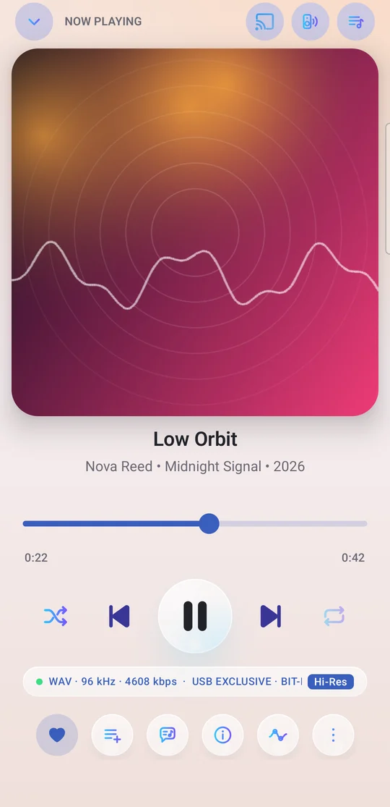
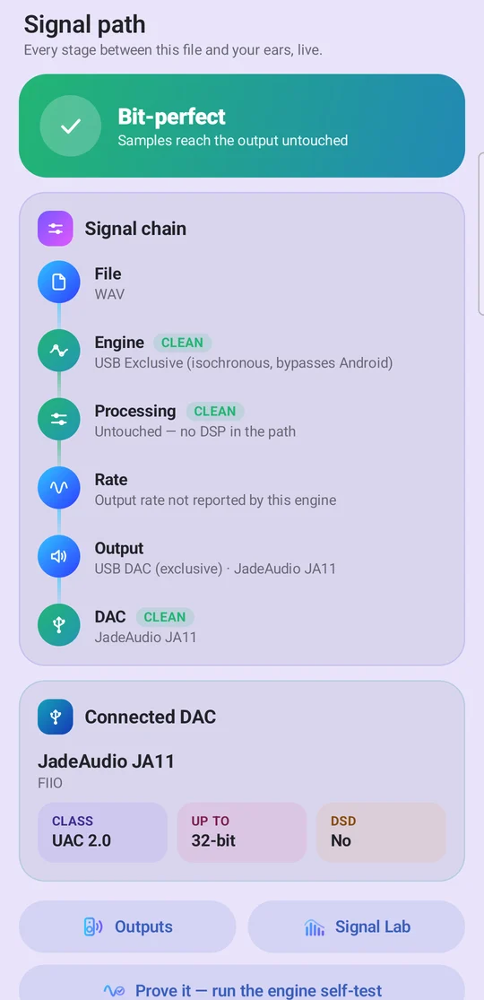
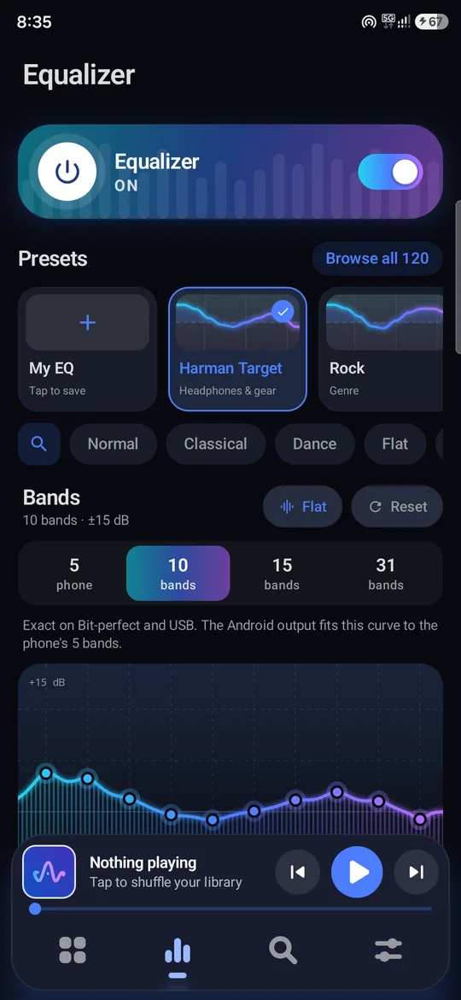
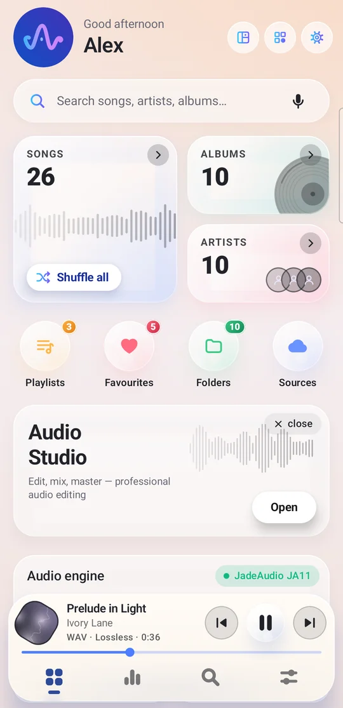
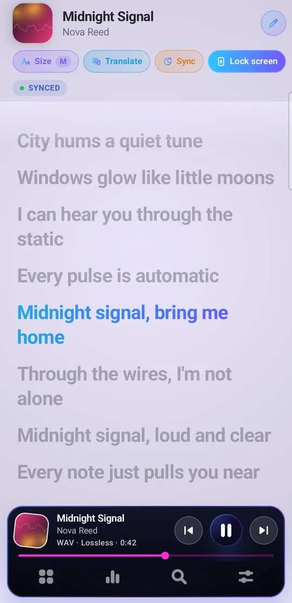
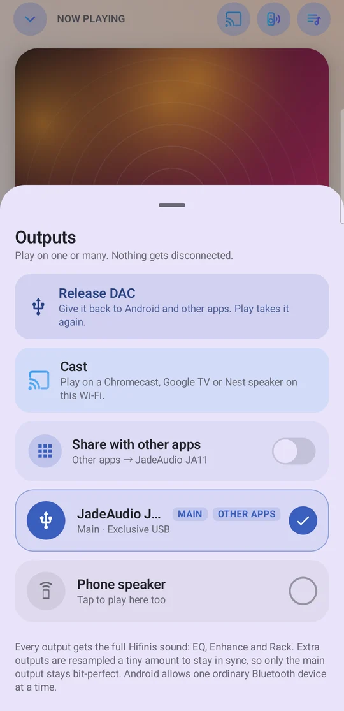
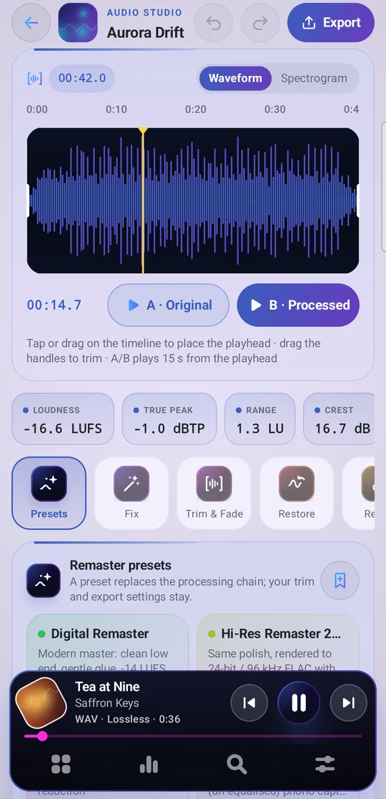
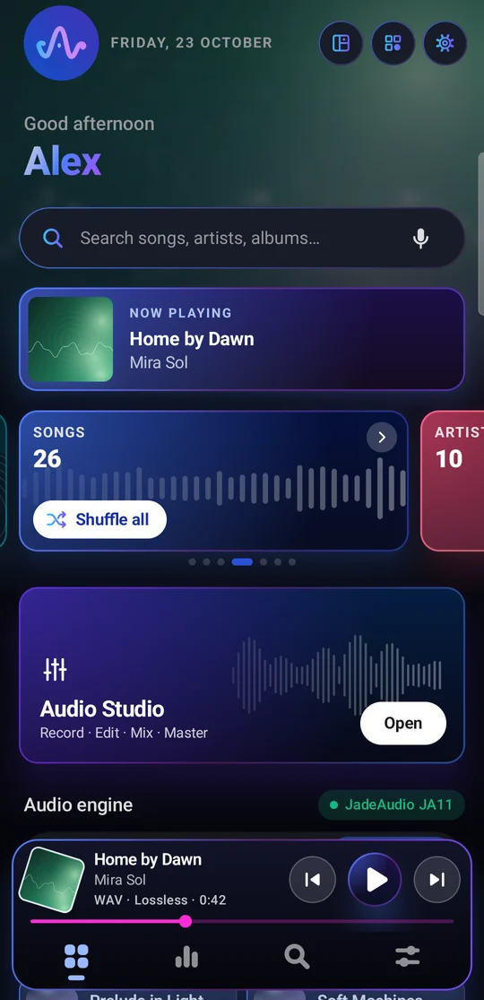

# Hifinis — Hi-Res Bit-Perfect Music Player for Android

**Hifinis** is an offline audiophile music player for Android, by **Curvio Studio**.
It plays your files the way they were recorded — bit-perfect to your USB DAC, with parametric and
31-band EQ, 120 presets, FLAC / ALAC / DSD, gapless, synced lyrics and a built-in Audio Studio.
No account, no ads.

**[⬇ Download the latest Hifinis APK](https://github.com/Parivallalin/hifinis/releases/latest)** · Android 8+

🌐 Website: https://parivallalin.github.io/hifinis/
🔒 Privacy policy: https://parivallalin.github.io/hifinis/privacy.html
⬇️ Download: https://github.com/Parivallalin/hifinis/releases/latest  ·  📣 Telegram: https://t.me/curviostudio
📱 Google Play: in closed testing — join via our Telegram group

## Features

- **Bit-perfect playback** — Android, Bit-perfect (AAudio) and Exclusive USB engines; every song at its own rate up to 384 kHz / 32-bit; DSD as DoP or native
- **See it, prove it** — live signal path from file to ears, engine self-test, DAC report, Signal Lab and spectrogram
- **Made for DACs & IEMs** — separate and hardware DAC volume, ear-safety start level, IEM −80 dB / Studio −90 dB curves, 0.5 % steps; every DAC, Bluetooth and wired headset keeps its own sound; USB-C ANC earphones keep their mic and noise cancelling
- **Every output at once** — DAC + Bluetooth + speaker together, each with its own level and sync; Chromecast / Google Cast
- **Equalizer** — 5/10/15/31-band graphic EQ, parametric EQ with up to 31 filters, 120 presets, live spectrum
- **Effects** — Hifinis Enhance (100 voicings), Processor Rack, Upscaler, crossfeed, spatial, reverb, loudness, volume boost
- **Lyrics** — embedded, .lrc/.srt/.ttml or online; big synced view; on-device translation; tap-to-sync; lock screen, widget and mini player
- **Audio Studio** — remaster (LUFS, true peak, A/B, restore), multitrack mixer and recording, mastering desk, stem splitter, karaoke, voice changer, Composer with 95 instruments and MIDI
- **Library** — folder-based; albums, artists, album artists, genres, composers, years, folders; rich sorting and format filters; tag editor with FLAC repair; playlist files (m3u/pls/xspf/wpl); Library Lab (fake hi-res, duplicates by sound); open songs from any file manager
- **Make it yours** — 29 Home designs, colour skins, light/dark/OLED, album-art colours, editable dock, widgets
- **Music world** — listening stats and Wrapped, share cards, tuner, metronome, alarm, backup & restore
- **Formats** — FLAC, ALAC, WAV, AIFF, APE, DSF/DFF, MP3, AAC/M4A, Ogg, Opus, WMA, MKA
- **Network sources (optional, beta)** — Jellyfin, Emby, Plex, Subsonic, SMB, WebDAV, DLNA, internet radio
- **Privacy** — no ads, no account; Curvio Studio never receives your music or listening history (translation and casting use Google components that send Google basic diagnostics — see the privacy policy)

## Support

Questions, bugs and feature requests: parivallalin@gmail.com

---

This repository hosts Hifinis' website and privacy policy. The app itself is closed-source.
© 2026 Curvio Studio. All rights reserved.
