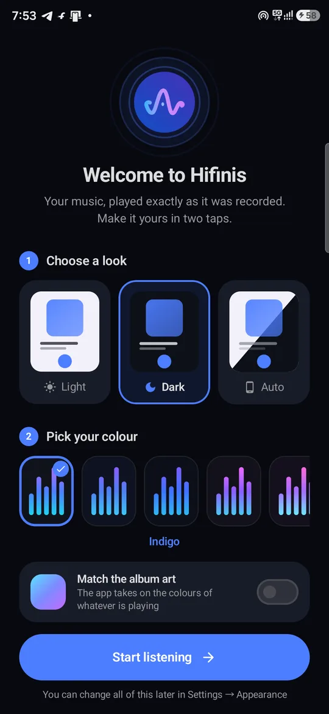
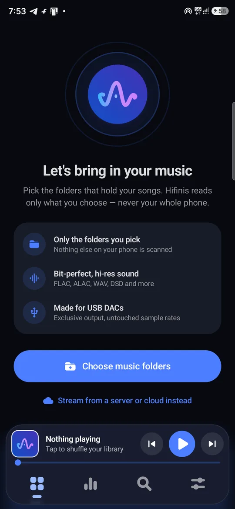
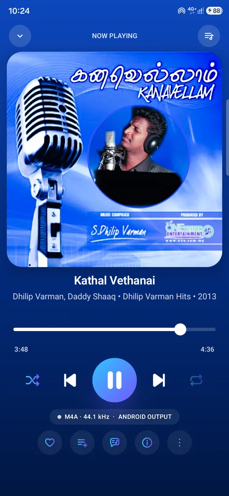
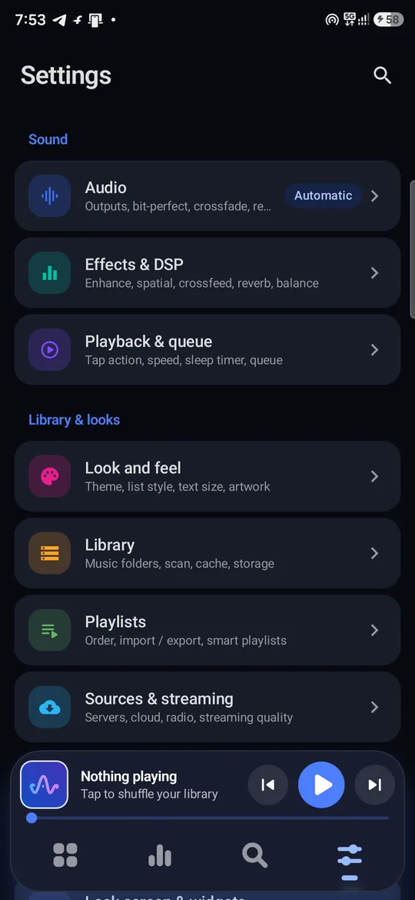
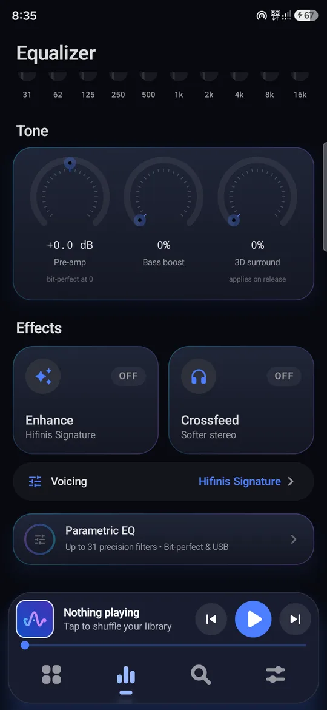
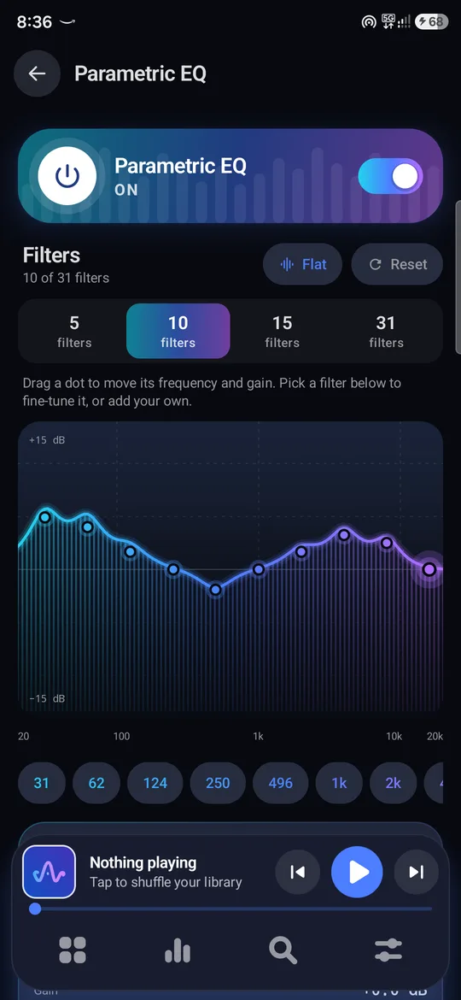

# Hifinis — Hi-Res Bit-Perfect Music Player for Android

**Hifinis** is an offline audiophile music player for Android, by **Curvio Studio**.
It plays your files the way they were recorded — bit-perfect to your USB DAC, with parametric and
31-band EQ, 120 presets, FLAC / ALAC / DSD, gapless, synced lyrics and a built-in Audio Studio.
No account, no ads, no tracking.

**[⬇ Download the latest Hifinis APK](https://github.com/Parivallalin/hifinis/releases/latest)** · Android 8+

🌐 Website: https://parivallalin.github.io/hifinis/
🔒 Privacy policy: https://parivallalin.github.io/hifinis/privacy.html
⬇️ Download: https://github.com/Parivallalin/hifinis/releases/latest  ·  📣 Telegram: https://t.me/curviostudio
📱 Google Play: coming soon

## Features

- **Bit-perfect playback** — Android, Native (Oboe) and Exclusive USB engines; up to 384 kHz / 32-bit and native DSD on USB DACs
- **Formats** — FLAC, ALAC, WAV, AIFF, APE, DSF/DFF, MP3, AAC/M4A, Ogg, Opus, WMA, MKA
- **Sound shaping** — parametric EQ with a live spectrum, 10/15/31-band graphic EQ, 100+ presets, Hifinis Enhance voicings
- **Processor Rack** — 17 live effects on every output: compressor, limiter, AutoEQ headphone correction, crossfeed, reverb, vocal remover and more
- **Signal Lab** — loudness (LUFS), true peak, stereo scope, spectrum and a bit-perfect check
- **Library Lab** — collection quality, fake hi-res detection, duplicates, ReplayGain, BPM & key
- **Your listening** — top artists and songs, listening clock, shareable Wrapped story; ListenBrainz scrobbling
- **Music tools** — chromatic tuner, metronome and a music alarm
- **Library** — folder-based scanning, tag editor, playlist files (m3u/pls/xspf/wpl), synced lyrics with on-device translation
- **Network sources** — Jellyfin, Plex, Subsonic, SMB, WebDAV, DLNA (optional)
- **Privacy** — no analytics, no ads, no accounts; nothing leaves your device

## Support

Questions, bugs and feature requests: parivallalin@gmail.com

---

This repository hosts Hifinis' website and privacy policy. The app itself is closed-source.
© 2026 Curvio Studio. All rights reserved.
